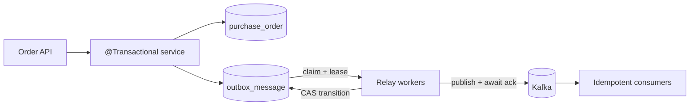

# Transactional Outbox Relay

[](https://github.com/wasiliy-strecker/transactional-outbox-relay/actions/workflows/verify.yml)
[](https://openjdk.org/projects/jdk/21/)
[](https://spring.io/projects/spring-boot)
[](https://kafka.apache.org/)
[](https://www.postgresql.org/)
[](LICENSE)

Reliable transactional outbox processing for Java and Spring Boot with PostgreSQL, Kafka, retries, leases, metrics, and Testcontainers.

This repository is a production-minded library and runnable reference application. It solves the database/message-broker dual-write problem without claiming impossible end-to-end exactly-once guarantees.

## What this demonstrates

- Atomic business-data and outbox writes in one Spring transaction
- Multi-worker PostgreSQL claiming with `FOR UPDATE SKIP LOCKED`
- Lease tokens and compare-and-set transitions for crash recovery
- Lease-safe chunking with bounded Java 21 virtual-thread concurrency
- Kafka acknowledgements, stable partition keys, and metadata headers
- Exponential backoff with jitter, retry exhaustion, and dead messages
- Spring Boot auto-configuration, type-safe properties, and replaceable SPIs
- Micrometer metrics, retention cleanup, Flyway migrations, and graceful lifecycle
- Unit, contract, and PostgreSQL/Kafka Testcontainers tests

## Architecture



The order row and event row commit together. Relay workers later claim small chunks, publish them concurrently, and record the broker acknowledgement only while they still own the lease.

### Delivery contract

| Property | Contract |
|---|---|
| Database/event atomicity | Yes, when `TransactionalOutbox` is called inside the same Spring transaction as the domain write |
| Broker delivery | At least once |
| Duplicate delivery | Possible after ambiguous acknowledgements or a crash between Kafka acknowledgement and database transition |
| Multi-worker safety | Lease token plus compare-and-set transitions |
| Crash recovery | Expired `IN_FLIGHT` rows can be reclaimed |
| Global ordering | Not guaranteed |
| Per-aggregate routing | Stable Kafka key; retries may still reorder events |
| Exactly once | Explicitly not claimed |

Read [delivery semantics](docs/delivery-semantics.md) before using the library in a real system.

## Run the complete example

Requirements: Docker with Compose support.

```bash
docker compose up --build
```

Create an order:

```bash
curl --fail-with-body \
  -H 'Content-Type: application/json' \
  -d '{"customerId":"customer-42","totalAmount":149.90,"currency":"EUR"}' \
  http://localhost:8080/api/orders
```

Observe the durable Kafka event:

```bash
docker compose exec kafka \
  /opt/kafka/bin/kafka-console-consumer.sh \
  --bootstrap-server kafka:29092 \
  --topic orders.events \
  --from-beginning \
  --property print.key=true \
  --property print.headers=true \
  --max-messages 1
```

The runnable example is in [`examples/order-service`](examples/order-service). `docker compose down` stops it; `docker compose down -v` also deletes the local PostgreSQL data.

## Use the Spring Boot starter

The project is currently a `0.1.0` development snapshot and is not yet published to Maven Central. Install it locally first:

```bash
./mvnw install
```

```xml
<dependency>
  <groupId>io.github.wasiliy-strecker</groupId>
  <artifactId>outbox-spring-boot-starter</artifactId>
  <version>0.1.0</version>
</dependency>
```

Include the library migration beside the application's migrations:

```yaml
spring:
  flyway:
    locations:
      - classpath:db/outbox/postgresql
      - classpath:db/migration
  kafka:
    bootstrap-servers: localhost:9092
```

Write the domain change and event in the same transaction:

```java
@Transactional
public Order save(Order order) {
  orderRepository.insert(order);

  outbox.appendJson(
      new OutboxEventMetadata(
          "orders.events",
          order.id().toString(),
          "OrderCreated",
          "v1",
          "Order",
          order.id().toString(),
          order.version(),
          order.createdAt(),
          Map.of("event-source", "order-service")),
      new OrderCreated(
          order.id(),
          order.customerId(),
          order.totalAmount(),
          order.currency(),
          order.createdAt()));

  return order;
}
```

Calling `appendJson` without an active Spring transaction fails fast. This prevents the example from silently degrading back into a dual write.

## Modules

| Module | Responsibility |
|---|---|
| `outbox-core` | Framework-free contracts, state model, retry policy, and relay coordinator |
| `outbox-store-jdbc` | PostgreSQL writer, claim SQL, lease transitions, cleanup, and Flyway migration |
| `outbox-publisher-kafka` | Kafka record mapping, acknowledgements, and error classification |
| `outbox-spring-boot-autoconfigure` | Transactional facade, properties, lifecycle, producer, and metrics |
| `outbox-spring-boot-starter` | One-dependency Spring Boot integration |
| `outbox-testkit` | Reusable store contract and deterministic clock |
| `examples/order-service` | Runnable REST API and end-to-end infrastructure test |

## Configuration

All settings use the `outbox.relay` prefix and have generated IDE metadata.

| Property | Default | Purpose |
|---|---:|---|
| `enabled` | `true` | Start the polling worker |
| `batch-size` | `100` | Maximum messages handled by one poll |
| `max-concurrency` | `8` | Maximum size of each claimed, concurrent chunk |
| `poll-interval` | `500ms` | Delay after each completed poll |
| `lease-duration` | `30s` | Exclusive ownership window |
| `max-attempts` | `10` | Attempt that moves a failing message to `DEAD` |
| `acknowledgement-timeout` | `10s` | Maximum Kafka acknowledgement wait |
| `max-payload-bytes` | `1048576` | Payload size guard |
| `retry.initial-delay` | `1s` | First retry delay |
| `retry.maximum-delay` | `5m` | Backoff ceiling |
| `retry.multiplier` | `2.0` | Exponential factor |
| `retry.jitter-ratio` | `0.2` | Proportional jitter |
| `cleanup.enabled` | `true` | Delete old published rows |
| `cleanup.retention` | `7d` | Minimum published-row age |
| `cleanup.interval` | `1h` | Minimum delay between cleanup attempts |
| `cleanup.batch-size` | `1000` | Maximum rows deleted per attempt |
| `worker-id` | generated | Diagnostic identity for leases |

## Observability

When a `MeterRegistry` is available, the starter records:

- `outbox.relay.messages` with `claimed`, `published`, `rescheduled`, `dead`, and `ownership_lost` outcomes
- `outbox.relay.poll.duration`
- `outbox.relay.poll.failures`
- `outbox.relay.cleanup.deleted`

See the [operations guide](docs/operations.md) for alerting signals, scaling, cleanup, and recovery queries.

## Build and test

```bash
# Formatting, compilation, unit tests, Javadocs, and packaging
./mvnw verify

# PostgreSQL store contract and full PostgreSQL -> Kafka flow
./mvnw -Pintegration verify
```

The integration profile requires a Docker-compatible runtime. CI runs the normal build on Java 21 and 25 and runs the infrastructure suite separately on Java 21.

## Design documents

- [Architecture](docs/architecture.md)
- [Delivery semantics and failure windows](docs/delivery-semantics.md)
- [Operations](docs/operations.md)
- [Contributing](CONTRIBUTING.md)
- [Security policy](SECURITY.md)

## Status

Pre-release portfolio project. The public API may still change before `1.0.0`; every guarantee documented here is intended to be testable and deliberately conservative.

Licensed under [Apache License 2.0](LICENSE).
