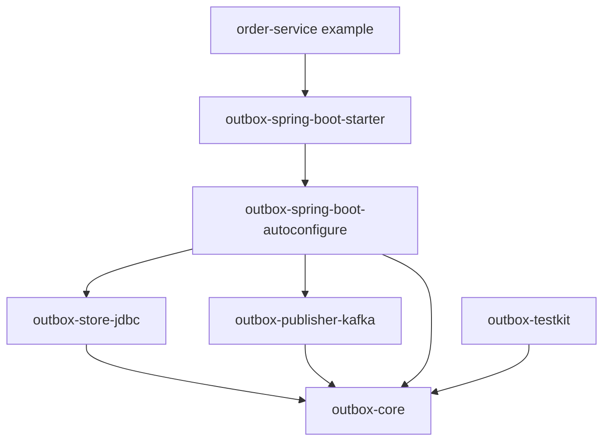
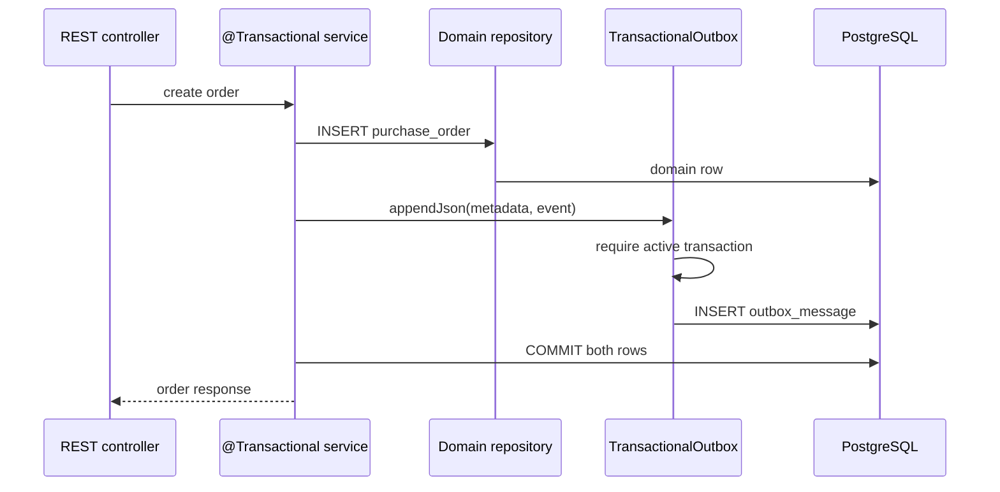
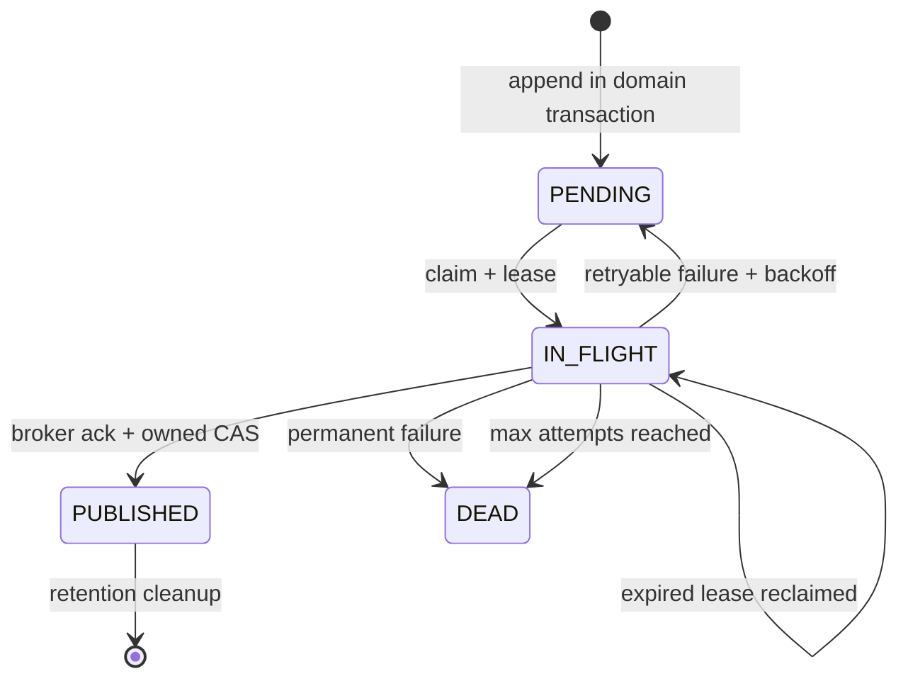

# Architecture

## Problem

A service often needs to change its database state and publish an event. A database commit and a Kafka send cannot be made atomic by a normal local transaction:

1. Commit the database first and a crash can lose the event.
2. Publish first and a database rollback can expose an event for a change that never happened.

The transactional outbox stores the domain change and serialized event in the same PostgreSQL transaction. Publication becomes a separate, recoverable process.

## Design goals

- Keep the write-side transaction local, short, and explicit.
- Allow several application instances to relay safely.
- Recover rows after process death without operator intervention.
- Bound payload size, claim size, concurrency, retries, and cleanup work.
- Separate the state machine from PostgreSQL, Kafka, and Spring Boot adapters.
- Describe failure semantics honestly enough for consumers to design deduplication.

## Non-goals

- End-to-end exactly-once processing
- Global event ordering
- Cross-database transactions
- Kafka transactions spanning the PostgreSQL commit
- A general-purpose workflow engine

## Component boundaries



`outbox-core` knows neither Spring nor JDBC nor Kafka. `OutboxStore`, `OutboxPublisher`, and `RetryPolicy` are replaceable boundaries.

## Write path



`JdbcTemplate` obtains the transaction-bound connection. `JdbcOutboxWriter` never commits or closes that caller-owned connection.

## Relay path

One poll handles at most `batch-size` messages. It does not lease that entire batch upfront. Instead it repeats this bounded cycle:

1. Claim at most `max-concurrency` rows in a short PostgreSQL transaction.
2. Give each row a worker name, random lease token, lease deadline, and incremented attempt.
3. Publish the chunk concurrently on Java 21 virtual threads.
4. Wait for the Kafka acknowledgement for every message.
5. Transition each row with `WHERE lease_token = ? AND lease_until >= ?`.
6. Claim the next chunk until the poll budget is exhausted or no work remains.

Chunked claiming avoids holding a lease while a message waits behind a large serial batch. The Kafka producer and PostgreSQL store are thread-safe; concurrency remains explicitly bounded.

## State machine



An expired row is reclaimed by the next claim statement and receives a new token. A late worker cannot overwrite the new owner's state because every transition compares the token and deadline.

## PostgreSQL concurrency

The claim statement selects eligible rows with:

```sql
FOR UPDATE SKIP LOCKED
```

and updates the selected rows in the same transaction. Competing workers skip rows already being claimed rather than waiting on them.

Partial indexes support:

- available pending rows;
- expired in-flight leases;
- published-row cleanup;
- aggregate diagnostics.

The database schema also enforces the relationship between `IN_FLIGHT` state and non-null lease fields.

## Kafka mapping

- `destination` becomes the Kafka topic.
- `partitionKey` becomes the record key.
- The serialized byte payload is sent unchanged.
- Caller headers are preserved.
- Reserved `outbox.*` headers carry message identity, event type, schema, aggregate, occurrence time, content type, attempt, and creation time.

The starter creates a dedicated producer from `spring.kafka` connection and security settings. It forces string-key and byte-array serializers and defaults to `acks=all` with producer idempotence enabled. Kafka producer idempotence does not remove duplicates across application restarts or database retry cycles.

## Extension points

- Implement `OutboxStore` for another durable store.
- Implement `OutboxPublisher` for another broker.
- Implement `RetryPolicy` for domain-specific delay behavior.
- Replace any Spring Boot bean with an application bean of the same boundary type.
- Use `outbox-testkit` to apply the reusable store contract to a custom store.

Store and publisher implementations must support concurrent transition and publish calls.
